<!-- cool-readme:start -->

<picture>
  <source media="(prefers-color-scheme: dark)" srcset="https://raw.githubusercontent.com/romainharlaut/romainharlaut/cards/summary-dark.svg">
  
</picture>
<picture>
  <source media="(prefers-color-scheme: dark)" srcset="https://raw.githubusercontent.com/romainharlaut/romainharlaut/cards/languages-dark.svg">
  
</picture>

<picture>
  <source media="(prefers-color-scheme: dark)" srcset="https://raw.githubusercontent.com/romainharlaut/romainharlaut/cards/contributions-dark.svg">
  
</picture>
<picture>
  <source media="(prefers-color-scheme: dark)" srcset="https://raw.githubusercontent.com/romainharlaut/romainharlaut/cards/weekly-dark.svg">
  
</picture>

<!-- cool-readme:end -->

<picture>
  <source media="(prefers-color-scheme: dark)" srcset="https://lastfm-recently-played.jeffreyca.workers.dev/svg?user=roms10&amp;theme=dark&amp;count=10&amp;width=1000&amp;radius=40&amp;stats=block-center&amp;footer=wave&amp;loved=between-all" />
  <source media="(prefers-color-scheme: light)" srcset="https://lastfm-recently-played.jeffreyca.workers.dev/svg?user=roms10&amp;theme=light&amp;count=10&amp;width=1000&amp;radius=40&amp;stats=block-center&amp;footer=wave&amp;loved=between-all" />
  
</picture>
